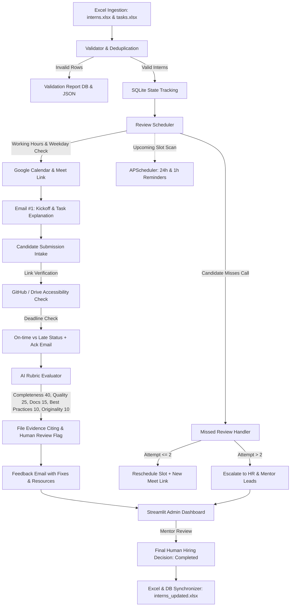

# AI Intern Review Automation System

An end-to-end, production-grade automated technical review lifecycle platform in Python. Built to handle cohorts of 100+ interns from raw Excel rosters through data validation, conflict-free scheduling, personalized notifications, submission verification, AI rubric evaluation, missed-review rescheduling, and Streamlit admin oversight.

---

## Architecture Overview



---

## Tech Stack & Core Libraries

- **Language:** Python 3.10+
- **Data & Excel Processing:** `pandas`, `openpyxl`
- **Configuration & Validation:** `PyYAML`, `python-dotenv`, `pydantic`
- **Database:** `SQLite3` (relational ACID state tracking, foreign keys, audit logging)
- **Meetings & Calendar:** Google Calendar API (v3) + synthetic Meet link generator
- **Email:** Standard library `smtplib`, `MIMEMultipart`, with strict idempotency guards & `DRY_RUN` mode
- **Submission Verification:** `requests` & GitHub REST API
- **AI Evaluator:** OpenAI API (`gpt-4o-mini`) + deterministic offline rubric evaluator
- **Job Scheduling:** `APScheduler` (BackgroundScheduler)
- **Admin Dashboard:** `Streamlit`
- **Testing:** `pytest`

---

## Implemented Features

1. **Data Validation & Hygiene:**
   - Detects and skips malformed emails, invalid phone numbers, empty fields, and unmapped domains.
   - Detects duplicate emails and duplicate phones across batches and database history.
   - Saves all issues to `validation_reports` table and writes `data/validation_report.json`.

2. **Conflict-Free Scheduler:**
   - Strictly enforces working hours (e.g. `09:00` to `17:00`).
   - Strictly excludes weekends (Saturday and Sunday).
   - Prevents overlapping slot conflicts across all interns.
   - Generates Google Meet links for every slot.

3. **Email #1 (Task Kickoff & Invitation):**
   - Personalized email with candidate name and beginner-friendly task explanation.
   - Review date/time, Google Meet link, submission deadline, and submission instructions.
   - Strict idempotency key (`intern_{id}_invitation_r{round}`) preventing duplicate emails.

4. **Intern Doubt & Q&A Handling (Step 3B):**
   - **Sender Identification:** Matches registered email or parses `[INT-xxx]` in subject line. If email does not match, challenges for Intern ID and the last 4 digits of the registered phone number before answering.
   - **Task Sheet Ground Truth:** Answers strictly using the candidate's assigned task Description, Requirements, and Evaluation Criteria.
   - **Conceptual Hints Only:** Clarifies requirements and provides architectural direction, but **NEVER** gives full solutions or complete code.
   - **Out-of-Scope Questions:** Stated clearly as not covered and forwarded to the human mentor without guessing.
   - **Deadline Extensions:** Never approved automatically; forwarded to mentor and marked under review.
   - **Privacy Enforcement:** Inquiries about other interns, comparative scores, or hiring odds are politely declined.
   - **Needs Mentor Support Flagging:** Repeated doubts or stuck candidates are automatically flagged for mentor intervention.
   - **Invariant Rule:** Doubts never count as missed reviews and never alter an intern's Round or Status.
   - **Logging & Excel Sync:** Every query and reply is recorded in SQLite and exported to `data/intern_queries.xlsx`.

5. **Submission Intake & Verification:**
   - Verifies GitHub repositories, Google Drive links, and public web links.
   - Extracts detected project files (e.g., `README.md`, `main.py`, `tests/`).
   - Compares submission timestamp against task deadline to classify `On-time` vs `Late`.
   - Sends submission receipt acknowledgement email.

5. **AI Rubric Evaluator:**
   - Scores strictly against task requirements using the 100-point rubric:
     - **Completeness:** 40 points
     - **Code Quality:** 25 points
     - **Documentation:** 15 points
     - **Best Practices:** 10 points
     - **Originality:** 10 points
   - Cites concrete files as evidence.
   - Never invents flaws; flags uncompressed archives or missing test suites as **Needs Human Review**.

6. **Feedback Email:**
   - Itemized score breakdown across all 5 rubric categories.
   - Key strengths identified.
   - Numbered mistakes with actionable code fixes.
   - Curated domain-specific learning resources.
   - Next steps guidance.

7. **Missed Review Handling & Rescheduling:**
   - Marks slot as `Missed` upon candidate absence or request.
   - Automatically reschedules to a new slot with a new Google Meet link up to **2 times**.
   - If max reschedules (2) is exceeded, immediately escalates to `ESCALATED` and dispatches an alert to HR & Mentor leads.
   - APScheduler sends **24-hour** and **1-hour** reminders before review slots.

8. **State Loop, Excel Sync & Human Hiring Oversight:**
   - Syncs state after every transition to `data/interns_updated.xlsx` (`Round`, `Status`, `Score`, `Next Date`, `Meet Link`).
   - Humans make all final hiring decisions in the Streamlit UI.

---

## Directory Structure

```
ai review automation/
├── .env.example              # Environment variables template
├── .env                      # Local environment configuration
├── config.yaml               # System parameters, rubric weights, working hours
├── requirements.txt          # Python dependencies
├── generate_sample_data.py   # Generates sample interns.xlsx & tasks.xlsx
├── run_demo.py               # Complete end-to-end demo execution in DRY_RUN
├── README.md                 # Project documentation
│
├── data/
│   ├── interns.xlsx          # 5 valid interns + 3 sample invalid rows
│   ├── tasks.xlsx            # 5 domain technical tasks
│   ├── validation_report.json# Generated validation report
│   └── interns_updated.xlsx  # Live synchronized output sheet
│
├── app/
│   ├── __init__.py
│   ├── config.py             # Typed Pydantic configuration loader
│   ├── db.py                 # SQLite database schema, CRUD, and audit logging
│   ├── models.py             # Pydantic models and Enums
│   ├── validator.py          # Feature 1: Data validation & deduplication
│   ├── calendar_service.py   # Calendar events & Google Meet link generator
│   ├── scheduler.py          # Feature 2 & 7: Conflict-free scheduler & rescheduling
│   ├── email_service.py      # Feature 3, 6, 7: Email templates, idempotency, DRY_RUN
│   ├── submission_service.py # Feature 4: Intake, link verification, on-time check
│   ├── ai_evaluator.py       # Feature 5: AI Rubric scoring, citations, human review
│   ├── reminder_service.py   # Feature 7: APScheduler 24h & 1h reminders
│   ├── pipeline.py           # Feature 8: Central orchestration pipeline
│   └── excel_sync.py         # Feature 8: Database to Excel synchronizer
│
├── dashboard/
│   └── app.py                # Streamlit admin dashboard
│
└── tests/
    ├── __init__.py
    ├── test_scheduler.py     # Weekend skipping, working hours, conflict checks
    ├── test_missed_review.py # Reschedule limits (max 2) & HR escalation
    ├── test_validator.py     # Invalid emails, duplicates, unmapped domains
    └── test_ai_evaluator.py  # Rubric limits, file citations, idempotency
```

---

## Quickstart & Setup Guide

### 1. Prerequisites
- Python 3.10+ installed on your system.

### 2. Install Dependencies
```bash
py -3.10 -m pip install -r requirements.txt
```

### 3. Configure Environment
Copy `.env.example` to `.env`:
```bash
cp .env.example .env
```
Key settings in `.env`:
```ini
DRY_RUN=true                    # Keep true to test without sending real emails
SMTP_HOST=smtp.gmail.com
SMTP_PORT=587
FROM_EMAIL=reviews@example.com
OPENAI_API_KEY=                 # Optional: falls back to deterministic evaluator if omitted
HR_EMAIL=hr-internships@example.com
```

### 4. Generate Sample Excel Files
```bash
py -3.10 generate_sample_data.py
```
This populates:
- `data/interns.xlsx` (5 valid candidates across domains + 3 deliberate edge cases: duplicate email, malformed email, unknown domain).
- `data/tasks.xlsx` (Backend, Frontend, AI/ML, Data Engineering, Mobile Development).

---

## Running Unit Tests

Run the full pytest suite:
```bash
py -3.10 -m pytest -v
```
All 8 unit tests verify:
- ✅ No weekend review slots (skips Saturday and Sunday).
- ✅ Review slots fall strictly between 09:00 and 17:00.
- ✅ Zero slot overlaps across consecutive candidates.
- ✅ Missed reviews reschedule up to 2 times, and escalate to HR on the 3rd miss.
- ✅ Validation skips invalid emails, duplicates, and unmatched domains.
- ✅ AI evaluator enforces the 100-point rubric and cites evidence files.
- ✅ Email idempotency strictly blocks duplicate dispatches.

---

## Running the End-to-End Demo

Run the comprehensive lifecycle demo in `DRY_RUN` mode:
```bash
py -3.10 run_demo.py
```
The demo will:
1. Validate inputs and generate `data/validation_report.json`.
2. Schedule review slots and print Email #1 invitations with Google Meet links.
3. Test email idempotency guards.
4. Scan and dispatch 24h & 1h reminder notifications.
5. Ingest submissions (including on-time GitHub repos, Drive archives, and late submissions).
6. Run the AI rubric evaluation, cite evidence files, and print feedback emails.
7. Simulate missed reviews for Candidate Vikram Malhotra through Reschedule 1, Reschedule 2, and escalation to HR.
8. Sign off on Candidate Aarav Sharma and export `data/interns_updated.xlsx`.

---

## Launching the Streamlit Admin Dashboard

Start the interactive web management interface:
```powershell
py -3.10 -m streamlit run dashboard/admin_dashboard.py
# or from root: py -3.10 -m streamlit run streamlit_app.py
```
Then open your browser at `http://localhost:8501`.

### Dashboard Features:
- **Overview & Interns:** Real-time KPI cards, full filterable intern table, search by name/email/domain.
- **Intern Detail & AI Review:** Candidate profile, meeting links, rubric breakdown (Completeness 40, Quality 25, Docs 15, Best Practices 10, Originality 10), cited file evidence, and **Human Hiring Decision buttons** (Approve / Reschedule / Escalate).
- **Pipeline Actions:** Trigger Ingestion, Schedule Pending, Dispatch Reminders, Intake Submissions, or Run AI Evaluation directly from the UI.
- **Validation Report:** Live view of all rejected/skipped rows with exact rejection reasons.
- **Audit & Email Logs:** Timestamped audit trail of every single system event and email dispatch.

---

## Security & Privacy Rules

- **Strict Privacy Isolation:** Emails are dispatched strictly one-to-one. No intern data, email address, or feedback is ever exposed to another intern.
- **No Hardcoded Secrets:** All credentials, keys, and tokens reside in `.env`.
- **Idempotency Guarantee:** Every notification is checked against SQLite `email_logs` with a unique composite key (`{intern_id}_{email_type}_{round}`) before dispatch.
- **Human-in-the-Loop:** AI evaluation provides objective rubric scoring and evidence citations; final hiring decisions always require human approval.
